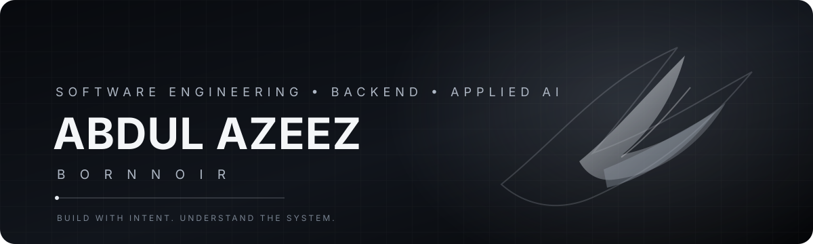

 

### Software engineering graduate · Backend & Full Stack · Applied AI

*I enjoy understanding how software works beneath the surface — and turning ideas into useful products.*

 

## 01 / About

Hey, I'm **Abdul Azeez** — an AI & Machine Learning engineering graduate interested in building reliable software, useful developer tools, and products that solve real problems.

My interests sit at the intersection of **backend engineering, full-stack development, systems fundamentals, and practical AI/ML**. I like learning by building, understanding trade-offs, and keeping things simple where simplicity works.

- Based in Bengaluru, India.
- Interested in backend and full-stack software engineering.
- Exploring how machine learning models become useful, reliable software features.
- Focused on strengthening computer science fundamentals and building demonstrable projects.

## 02 / Technologies

The tools and technologies I have worked with or am developing practical experience in:

**Languages**

**Backend & APIs**

**Frontend**

**Data & AI/ML**

**Tools**

## 03 / What I'm exploring

| Area | What interests me |
|:--|:--|
| **Backend engineering** | API design, authentication, databases, maintainable services |
| **Systems fundamentals** | Data structures, networking, concurrency, operating systems |
| **Full-stack products** | Building useful interfaces backed by reliable services |
| **Applied AI** | Model inference, serving, and integrating ML into applications |

## 04 / Selected work

I use this profile to document projects as I build, test, and improve them. I’ll feature projects here when their code, documentation, and implementation are ready to be reviewed.

> Prefer a few complete, explainable projects over a long list of unfinished ideas.

**Project links will be added here as each project is completed.**

## 05 / GitHub activity

Stats are generated by a community-hosted service and may occasionally be unavailable or rate-limited.

## 06 / Let's connect

I'm always happy to connect with people who enjoy building software, learning how systems work, and sharing ideas.

 

**Thanks for stopping by.**

Build with intent. Understand the system.

